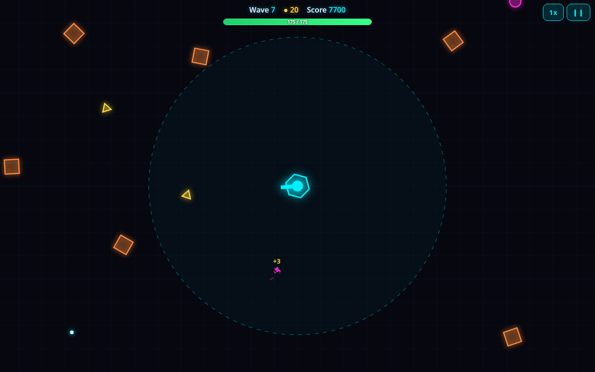

# Last Stand Tower

A small "last stand" tower defense game for the browser, in a chunky cartoon style. Your tower (it has a face!) sits in the middle of a lawn and fires on its own at enemies closing in from every side. Survive each wave, then pick an upgrade card before the next one.

**[Play it here](https://awsumbtech.github.io/last-stand-tower/)** (works on desktop and mobile, installable, plays offline)

**[Art style preview](https://awsumbtech.github.io/last-stand-tower/styles.html)**: the same scene in neon, pixel art, and cartoon styles (cartoon is the game's look).



## How to play

- Press **Start**. The tower aims and shoots by itself.
- Enemies that reach the tower damage it. If its HP hits zero, the run is over.
- Kills give coins. After every wave the **shop deals 3 cards**:
  - **Take one for free.** You have to pick one before the next wave starts.
  - **Want more?** Each extra card from the same deal costs coins, and the price doubles for every extra you buy in that shop. Prices also rise with the wave.
  - **Reroll** re-deals the cards you haven't taken (coins, doubling per reroll).
  - **Repair** heals 40% of max HP for coins (rising per repair).
  - Every deal has at least one attack card, and after a boss wave at least one card is Rare or better.

Your first run uses the four **starter cards** (Damage, Fire Rate, Range, Max HP). The other cards are unlocked
with **Gears** in the Workshop (see below), and the shop only deals cards you've unlocked.

| Card | Rarity | Effect (per level, max) | Unlock |
| --- | --- | --- | --- |
| Damage | Common | +30% of base damage (no cap; additive so it can't snowball) | starter |
| Fire Rate | Common | +10% shots per second (max 12) | starter |
| Range | Common | +20 range (max 6) | starter |
| Max HP | Common | +30 max HP and heals 30 (max 15) | starter |
| Multishot | Rare | +1 target per volley (max 4) | 15 Gears |
| Lucky Shot | Rare | +7% crit chance (max 5) | 35 Gears |
| Pierce | Rare | Shots pass through +1 enemy (max 2) | 100 Gears |
| Frost Shots | Rare | Hits slow enemies by 15% more, bosses half as much (max 3) | 75 Gears |
| Regen | Rare | +0.5% max HP per second during waves (max 4) | 50 Gears |
| Splash | Epic | Hits blast nearby enemies for 35%, then +15% and bigger radius (max 2) | 190 Gears |
| Vampire | Epic | Each kill heals 0.5% max HP (max 3) | 140 Gears |
| Overcharge | Epic | Crits deal +100% damage (max 1) | 250 Gears |

### Trap cards ("Gotcha!")

From wave 4, about 1 deal in 5 hides a **trap**: a card that sounds great but has a catch. Traps look like normal
cards and cost the same. The tell is the wording and a tiny grey line of fine print, so read carefully. The first time
you take one, it flips over at the end of the next wave with a **Gotcha!** and goes into your **Codex**. After that,
copies show an **eye icon** and their real effect.

| Trap | Shown as | Says | Really does |
| --- | --- | --- | --- |
| Glass Cannon | Epic | +35% damage! | ...and max HP x0.6 (cursed: good with Regen/Vampire/Armor) |
| Big Bertha | Rare | +80% damage per shot | ...but -45% fire rate, -30% shot speed: no DPS gain |
| Long Shot | Common | +90 range | ...and -15% damage; enemies are already in range (dud) |
| Thorns | Rare | Enemies touching the tower take 300% of their HP | the 300% does nothing (they already pop on contact); it only bounces 25% of boss slam damage back |
| Overclock | Rare | +40% fire rate | for 3 waves, then -20% fire rate for the rest of the run |
| Hot Streak | Common | Crits hit x3! | ...and every shot -15% damage: only good with high crit chance |
| Piggy Bank | Rare | +40% Gears this run | ...for -3% damage (a real trade: weaker run, faster Workshop) |
| Mystery Box | Epic | Could be anything! | 50% a Common, 25% a Rare/Epic, 25% another trap |

- Enemies: **pink blobs** (basic), **yellow teardrops** (fast), **orange helmets** (tanky), plus **Big Red**, a horned boss, every 5th wave.
- Your best wave is saved in the browser.

### Bosses, the finale and Endless

- **Mini-bosses (Big Red)** come on waves 5, 10 and 15, then 25, 30, 35... in Endless. Big Red walks in to range 170 and
  stops. Every 3 s it rears up behind a red warning ring (0.8 s) and **slams** the tower, and every 6 s it calls in 2 blobs.
  The tower **shoots it first whenever nothing is within 120 of the tower**, and a big HP bar shows up at the top.
  Killing it pays **+25 coins** (x Greed) and **+3 Gears**. If you can't kill it within 35 s it gets bored and
  **charges** the tower for double contact damage (and pays nothing). The first two go easier (wave 5: half HP, 60% slam;
  wave 10: 80% HP, 85% slam). Big Red HP = 400 x (wave HP multiplier ^ 0.8), slam = 12 x wave damage multiplier.
- **Wave 20 is the FINALE.** No normal enemies: the lawn goes dark, a FINALE banner slams in, and **King Mole** digs up
  (1900 x wave HP multiplier, about 132k HP). He pops up, slams and calls minions for a few seconds, then burrows (can't be
  hit) and pops up somewhere closer. Three phases at 66% and 33% HP, each with a banner, faster slams, nastier minions
  (blobs, then teardrops, then helmets), pop-ups closer to the tower, and darker, faster music.
- **Beat him** and you get a victory party and the **World cleared!** screen: **+250 Gears** the first time (+75 after
  that), paid and saved right away. The Backyard is marked as cleared in your save (world 2 arrives in a later update).
  Then choose **Continue (Endless)**: waves keep scaling, with a mini-boss every 5 waves; or **Return to Workshop**: the run
  ends and pays its Gears. Losing to King Mole is a normal results screen.
- Head Start can't skip King Mole until you've beaten him once (it stops at wave 16).

### Active ability

A big round button (bottom-left on phones, bottom-center on desktop; **Q** on a keyboard) fires your ability. Its
cooldown only ticks during waves, and it starts each run charged.

| Ability | Effect | Cooldown | Unlock |
| --- | --- | --- | --- |
| Shockwave | Knocks enemies within 330 back 120 and stuns them for 1.5 s (bosses: 35 back, 1.2 s); cancels a slam wind-up | 25 s | starter |
| Freeze | Slows every enemy 60% for 4 s (bosses half as much) | 25 s | 150 Gears |
| Overdrive | 2x fire rate for 5 s | 25 s | 250 Gears |

You equip one at a time, on the **Deck** tab of the Workshop.

### Gears and the Workshop

When the tower falls, the **results screen** shows your wave, time, kills, coins, the cards you took, and the
**Gears** you earned. Gears last between runs:

`Gears = floor(2 × wave^1.3 + 3 × boss waves cleared + 3 × mini-bosses killed)`, so wave 10 pays 42, wave 13 pays 62, and wave 20 pays 107 (plus 3 per Big Red you killed, and the World cleared bonus).

Spend them in the **Workshop** (from the start screen or the results screen) to unlock cards. Locked cards show as
silhouettes with their effect, so you can plan. Prices: Multishot 15, Lucky Shot 35, Regen 50, Frost Shots 75,
Pierce 100, Vampire 140, Splash 190, Overcharge 250. A first run usually pays for Multishot and Lucky Shot.
Until Multishot is unlocked, enemy HP grows a little gentler over the first 10 waves (+20% per wave instead of
+25%), so a commons-only first run doesn't hit a wall.

The Workshop has four tabs:

- **Cards:** unlock new cards for the shop.
- **Upgrades:** lasting boosts for every run. Level n+1 costs `round(base × growth^n)` Gears.

  | Upgrade | Per level | Base / growth / max |
  | --- | --- | --- |
  | Power | +5% damage | 12 / 1.15 / 60 |
  | Rapid | +3% fire rate | 12 / 1.17 / 30 |
  | Armor | damage taken x0.97 per level (-26% at 10, -46% at 20, max 65% at 35) | 14 / 1.2 / 35 |
  | Bank | +15 starting coins | 15 / 1.30 / 15 |
  | Greed | +4% coins per kill | 20 / 1.22 / 25 |
  | Sharp Eye | +1% crit chance | 25 / 1.25 / 15 |
  | Head Start | start 5 waves later (up to 85% of your best wave; not past King Mole until you've beaten him) | 30 / 1.4 / 10 |
  | Appraisal | L1 cursed traps wobble, L2 fine print in full, L3 return a trap within 1 wave | 40 / 120 / 300 |

- **Deck:** pick your active ability (Shockwave, or unlock Freeze / Overdrive), and bench up to 2 cards so they never show up in the shop (keep at least one attack card).
- **Codex:** every card you've been dealt and every trap you've found ("GOTCHA" stamp). Tap one for its real effect and a lesson tip.

Armor used to be +6% max HP. Saves from before keep their Armor level (up to the new max of 35); Gears spent on levels
above 35 are refunded, and the start screen says so once.

**Head Start** replays the skipped waves' shops as a quick draft: each hand pays that wave's coins and gives a free
pick, with extras at that wave's prices. **Auto-draft** does all but the last hand for you. Tap the Head Start chip
on the start screen to choose the start wave.

Progress is saved in `localStorage` under `lst.meta` (versioned; older saves migrate automatically). Your best wave
keeps its old key (`lst.bestWave`). Players from before Gears existed get a one-time Gears payout for their best wave.
**Settings** (gear button on the start screen, or the pause menu) has the sound switches and **Reset progress**
(with a confirm).

- Shots can **crit** for double damage (big orange numbers). Drop below 25% HP and time slows for a moment as a warning.
- A typical first run lasts about 5 minutes (wave 10-12). With every card unlocked, a fresh run reaches wave 14-15 in about 7-8 minutes; King Mole usually falls around run 11-17, after some Workshop upgrades.

Controls: **Space / P / Esc** pause, **Q** fires the ability, **F** toggles 1x/2x speed, **M** toggles music, **Enter** starts or goes to the next wave, **W** opens the Workshop from the menu or results screen. In the shop, **1 / 2 / 3** take a card, **R** rerolls, and **H** repairs. On mobile, tap the buttons.

## Sound

Every sound effect and the background music are synthesized in code with the Web Audio API
(`src/audio.js`); there are no audio files. Audio starts on your first tap or key press (browsers
require that). The speaker and note buttons in the HUD mute sound effects and music separately,
and the pause menu has the same switches plus **Vibration** on phones that support it. Settings are
saved in the browser.

## Install it as an app

- **iPhone / iPad (Safari):** open the play link, tap **Share**, then **Add to Home Screen**.
- **Android (Chrome):** open the play link, tap **⋮**, then **Install app** (or **Add to Home screen**).
- **Desktop Chrome / Edge:** click the install icon in the address bar.

After the first visit the game works offline. When a new version is deployed you'll see a
"New version available" toast; tap **Refresh** to update.

## Art styles

The game uses the **Cartoon** style. `styles.html` shows one small animated scene in all three looks
(**Neon**, **Pixel**, **Cartoon**); tap the tabs or swipe the preview. To compare in the real game, add
`?style=neon` or `?style=pixel`, for example
[awsumbtech.github.io/last-stand-tower/?style=pixel](https://awsumbtech.github.io/last-stand-tower/?style=pixel).

## Run locally

No build step or dependencies. Clone the repo and serve the folder:

```bash
git clone https://github.com/awsumbtech/last-stand-tower.git
cd last-stand-tower
python3 -m http.server 8000
# open http://localhost:8000
```

Opening `index.html` directly also works (without offline support, since service workers need http).

## Code layout

| File | What it does |
| --- | --- |
| `src/config.js` | All balance numbers: tower stats, enemy types, wave scaling |
| `src/upgrades.js` | Shop cards (rarity, effect, cap) and the shop rules (draw, prices). Add an entry to add a card |
| `src/traps.js` | The 8 trap cards: what they say, the fine print, what they really do, Codex lessons |
| `src/meta.js` | Lasting progress: Gears, card unlocks, Workshop upgrades, Head Start, bench, versioned save + migrations |
| `src/waves.js` | Which enemies are in each wave and how they scale |
| `src/entities.js` | Tower, Enemy (incl. the mini-boss fight), KingMole (the finale boss), Projectile, Particle, FloatText |
| `src/settings.js` | Saved settings (sound, music, vibration) and haptics |
| `src/audio.js` | Synthesized sound effects and looping music (Web Audio API) |
| `src/world.js` | Shared simulation: entity lists, targeting, edge spawning, effects |
| `src/game.js` | Game state, wave flow, coins and score (extends World) |
| `src/render.js` | Canvas setup, sizing, world transform, shake; delegates the look to a theme |
| `src/themes/*.js` | Art styles: `cartoon` (default), `neon`, `pixel`. Each draws background, tower, enemies, shots, effects |
| `src/demo.js` | Self-running scene used by `styles.html` |
| `src/pwa.js`, `sw.js` | Service worker registration, offline cache, update toast |
| `manifest.webmanifest`, `icons/` | App name, colors and icons (regenerate icons with `python3 tools/make_icons.py`) |
| `fonts/` | Bundled [Fredoka](https://github.com/hafontia/Fredoka-One) font (SIL Open Font License, see `fonts/OFL.txt`) |
| `src/ui.js` | HUD and menu screens (HTML overlays) |
| `src/main.js` | Startup, game loop, keyboard shortcuts |
| `tools/sim.js` | Headless balance simulator (see below) |

The game object is on `window.game` for poking around in the browser console.

## Balance simulator

`tools/sim.js` runs the real game code in Node, with no browser, and plays seeded runs using scripted shop strategies (`casual`, `skilled`, focus builds, `noRepair`):

```bash
node tools/sim.js --runs 50 --shop-seconds 6        # death wave + real minutes per strategy
node tools/sim.js --favor                            # dominance check: always take card X (and each trap, forced into a wave-4+ deal)
node tools/sim.js --favor --traps-only --runs 150    # just the trap check
node tools/sim.js --upgrade-check --gears 1500       # Workshop check: one fixed Gear budget on a single upgrade
node tools/sim.js --config tweaks.json               # try CONFIG overrides: { "config": { ... } }
node tools/waves-table.js sim-results.json skilled   # per-wave pressure / DPS / coins table
node tools/sim.js --unlocked starter                 # only the starter cards (first run); or --unlocked multishot,crit
node tools/sim.js --campaign --campaigns 8 --hours 10  # meta model: unlocks, upgrades, Head Start, run lengths per hour,
                                                     #   boss kill rate per boss wave, the run King Mole is first beaten
node tools/sim.js --no-ability                       # bots never use the ability (they fire it when something is close or a boss winds up)
node tools/sim.js --meta --prestige                  # older planning model (lasting stat upgrades + prestige)
```

**Deploying changes:** bump `VERSION` in `sw.js` whenever you change files, so installed copies pick up
the new version (and add any new files to its `PRECACHE` list).

## Roadmap ideas

- More enemy types: ranged shooters, splitters, shielded enemies
- Chain lightning and more card types
- See [docs/ROADMAP.md](docs/ROADMAP.md): Workshop stat upgrades and Head Start, trap cards, worlds, Rebuild (prestige)
- Daily challenge seed and online leaderboard
- Pick an art style in the game's settings
